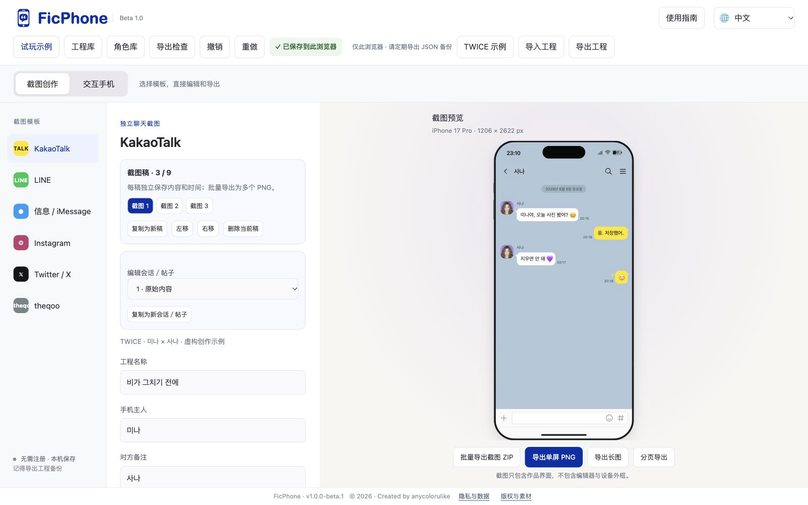

# FicPhone · Found-phone story maker and chat screenshot editor

Create interactive found-phone stories, K-pop fanfiction and social media AUs in your browser. Readers can open apps, explore conversations, browse photos and follow clues through a fictional phone. You can also create standalone chat, social media and forum screenshots.

**[Open FicPhone Studio](https://anycolorulike-l.github.io/ficphone/studio.html)** · [Play the demo](https://anycolorulike-l.github.io/ficphone/demo.html) · [中文操作指南](README.zh-CN.md)

Current version: `v1.0.1-beta.1`. Free to use. The editor runs in your browser and requires no account. Desktop browsers give you the most room to edit and preview. Open **User guide** in the editor for illustrated steps in English and Chinese.

| Mode | What you can make |
| --- | --- |
| Screenshots | KakaoTalk, LINE, Messages / iMessage, Instagram, X and theqoo templates. Set different times and content for up to nine drafts and export them together as PNGs in a ZIP. |
| Interactive phone | A fictional phone with chats, posts, albums, notes and call history. Set up to 13 story steps and export a standalone HTML file. |

The [FicPhone homepage](https://anycolorulike-l.github.io/ficphone/) links to the studio and the [interactive stories gallery](https://anycolorulike-l.github.io/ficphone/works.html). The editor supports Chinese, English, Korean and Japanese. Phone and hint languages can be set separately.

## Make a screenshot

1. Select **Screenshots**, then pick a chat or social template.
2. Open **Chat script** or the post settings. Enter one message per line, for example `Sana: [23:08] Hello!`. Use the individual message editor to attach images or voice recordings. In X or theqoo, indent a new comment by two spaces or press Tab to reply to the nearest top-level comment.
3. Set the device and time under **Canvas**. Under **Fonts & size**, use a preset or choose 7–30 pt. For a clean slate, use **Clear template** in the editing area. Check the preview. Export a single PNG, a long image, or multiple pages. To make a set with different content, duplicate the draft, edit each copy, then choose **Export screenshot ZIP**.

## Make an interactive phone

1. Select **Interactive phone**. In **Phone appearance**, choose a device, set the wallpapers, and choose whether the story starts on the lock screen or home screen. Select **Screen only** for a borderless reader view. An optional four- or six-digit passcode gives readers a keypad on the lock screen.
2. Under **Home screen apps**, enable the apps readers should find, assign them to one of two pages, and configure the Dock and first-page widgets. Add conversations and posts under **App content**, and add your photos and notes under **Albums & notes**.
3. In **Story triggers**, connect reader actions to new messages, notes, app unlocks, choices or endings. For a message, select the app and destination conversation. You can set a withdrawal delay, offer a scripted reply or configure the hint language here.
4. Play through the story in the preview, then choose **Export interactive HTML**. Readers can open that file in a browser.

## Share an interactive story

- **Self-host** — Upload the exported HTML to a static web host and share the resulting reader URL. The studio URL opens the editor.
- **Publish with an invite** — When the site has enabled publishing, open **Publish to FicPhone** in Interactive phone, enter an invite code and the work details, then copy the reader link. **List in the gallery** adds the work to the public gallery. An unlisted work can still be opened by anyone with its link. The publishing payload limit is 5 MiB.

## Save and continue later

FicPhone autosaves drafts in the current browser. Use **Back up project** to download an editable JSON copy, and **Import project** to reopen it. PNG and HTML are finished works. If you want to reuse your current phone setup, **New blank story with these settings** saves the original to your project library before creating the blank work.

Click the version number in the editor footer to see what changed. Use **User guide** for the current steps in English or Chinese. The walkthrough below was recorded in an earlier beta, so the toolbar and panel layout may differ.

[Feature overview video](docs/guide-assets/FicPhone-overview-en.mp4) · [Step-by-step walkthrough](docs/guide-assets/walkthrough-en.mp4) · [查看中文操作指南](README.zh-CN.md)
