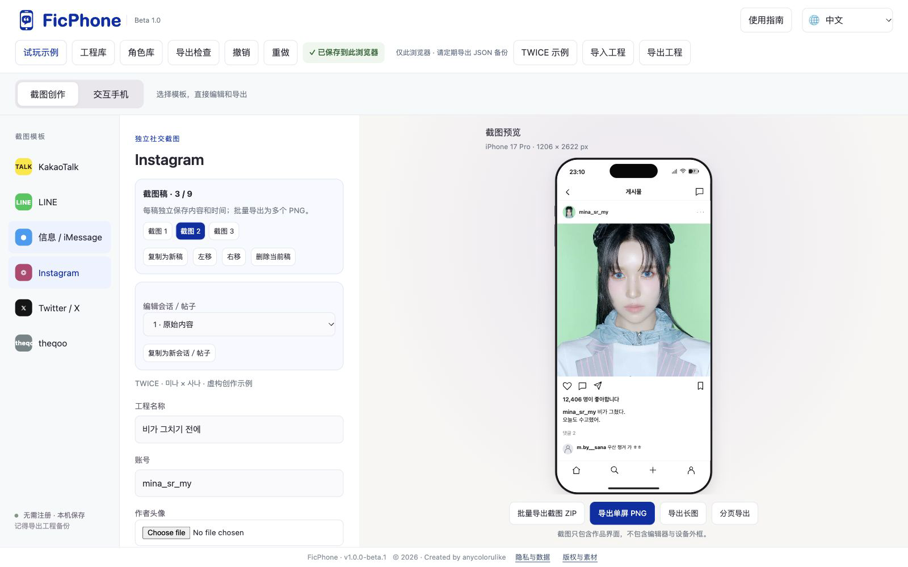
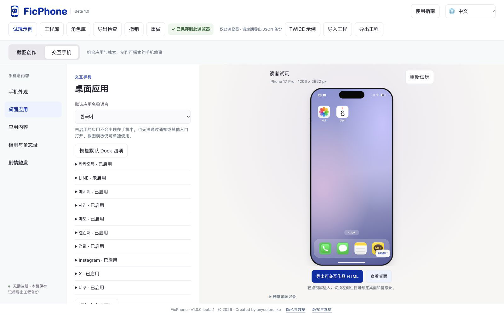
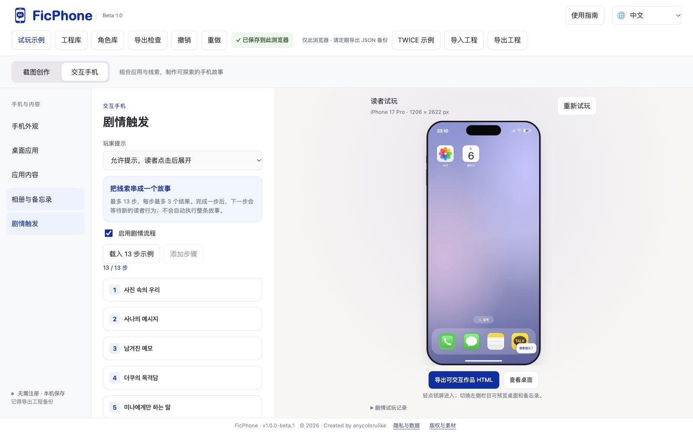
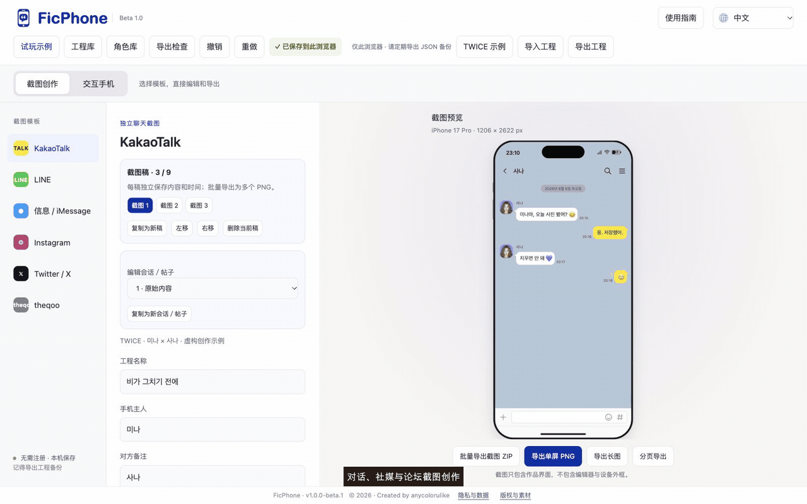

# FicPhone · 互动「捡手机」与截图创作工具

**想让读者真的点开聊天、翻相册、找线索？用网页编辑器制作一部可以探索的角色手机，也可以单独制作聊天、社媒和论坛截图。**

## 👉 [直接打开 FicPhone，开始创作](https://anycolorulike-l.github.io/ficphone/)

[📱 先玩互动示例](https://anycolorulike-l.github.io/ficphone/demo.html) · [📖 查看使用指南](#1-打开工具并选择创作模式)

免费使用，无需注册或下载安装，建议用电脑浏览器创作。点击上方链接即可进入工具；站内右上角提供图解教程。

草稿保存在当前浏览器，请定期导出 JSON 工程备份。互动作品可导出 HTML；目前不提供一键托管作品。

---


当前版本：`v1.0.0-beta.1`。右上角可选择跟随系统，或切换中文、English、한국어、日本語；作品内手机语言单独设置。

<p align="center"></p>

**Created by anycolorulike**

在浏览器中制作聊天截图、社交媒体／论坛体，或可探索的互动手机故事。支持 KakaoTalk、LINE、Messages / iMessage、Instagram、X 和 theqoo。

## 1. 打开工具并选择创作模式

网站首页是编辑器；点击顶部的 **试玩示例** 可以体验读者看到的互动手机。

| 你的目标 | 选择的模式 | 导出结果 |
|---|---|---|
| 制作聊天、动态或论坛截图 | 截图创作 | PNG 单屏、长图或分页图片 |
| 制作可探索的手机故事 | 交互手机 | 独立 HTML 作品文件 |

使用公开网页不需要注册。[点击这里打开编辑器](https://anycolorulike-l.github.io/ficphone/)，再选择创作模式。

## 2. 制作聊天截图

1. 点击 **截图创作**，选择 KakaoTalk、LINE 或 Messages。
2. 填写 **手机主人**、**对方备注**，上传头像。
3. 在 **对话脚本**中，每行使用 `名字：消息`。名字与手机主人一致，或写“我”，会显示为本人发送的消息。
4. 选择 **画布预设**，调整时间、电量和语言，查看右侧预览。
5. 点击 **导出单屏 PNG**、**导出长图**或**分页导出**，生成后点击缩略图保存。

脚本格式：

```text
사나：미나야아 뭐 해? 😊
미나：게임 중.
사나：또? 나보다 게임이 더 좋아? ㅋㅋ
미나：🙄
```

要插入聊天图片，先上传 **聊天图片**，再在脚本中使用 `名字：[图片]`。


## 3. 制作社交动态和论坛截图

1. 在 **截图创作**中选择 Instagram、X 或 theqoo。
2. 填写账号、正文、发布时间、评论等内容；theqoo 还可填写版面、分类和帖子标题。
3. 评论每行使用 `用户名：评论内容`，显示顺序与输入顺序一致。
4. 上传需要的头像或帖子图片，确认预览后导出 PNG。

各模板分别保留内容；同一模板的内容也可用于交互手机。



## 4. 制作交互手机

1. 点击 **交互手机 → 手机外观**，设置手机主人、机型、锁屏介绍和壁纸。
2. 在 **桌面应用**中配置应用、图标、名称、语言和 Dock。
3. 在 **应用内容**中编辑聊天、社交动态、通话和日历内容。
4. 在 **相册与备忘录**中加入照片和备忘录。多篇备忘录显示列表，只有一篇时直接进入该篇。
5. 在 **剧情触发**中设置连续步骤。
6. 使用右侧手机试玩；点击 **重新试玩**可清除本次试玩进度。
7. 完成后点击 **导出可交互作品 HTML**。

应用状态：

| 设置 | 效果 |
|---|---|
| 启用此应用 | 应用参加作品，按设置显示在桌面或 Dock |
| 关闭“启用此应用” | 应用不参加作品，入口隐藏；截图模板仍可单独使用 |
| 开始时锁定 | 应用参加作品，但等待剧情中的“解锁应用”结果后才出现 |



## 5. 设置连续剧情和分支

全作品最多 **13 步**，所有分支共用这 13 步；每步最多 **3 个结果**。

1. 在 **剧情触发**中添加步骤，填写步骤名称。
2. 选择 **触发行为**和**指定内容**，例如查看某张照片或打开某篇备忘录。
3. 按需设置延迟和额外前置线索；两条线索可选择“全部满足”或“任意一条满足”。
4. 在 **接下来发生**中添加结果。
5. 若添加“让读者作出选择”，填写两个选项，并指定各自进入的后续步骤。
6. 在右侧试玩，展开 **剧情试玩记录**，检查当前等待项和已触发事件。

| 配置 | 支持内容 |
|---|---|
| 触发行为 | 打开作品、查看照片、打开备忘录、进入聊天、打开帖子详情、查看通话详情、打开应用 |
| 额外线索 | 最多两条，全部满足或任意一条满足 |
| 延迟 | 0–60 秒 |
| 后续结果 | 追加消息、新增备忘录、解锁应用、读者选择、显示结局 |
| 选择分支 | 两个选项，可向后跳转到指定步骤或结束故事 |

后续步骤会等待新的读者行为。修改工程会重置编辑器中的试玩进度。

可以点击 **载入 13 步示例**学习配置；载入前请先导出自己的工程备份。



## 6. 保存、备份和继续编辑

- 编辑器自动保存到当前浏览器，可在工程库另存多个副本，并保留最近一次保存前的恢复副本；本机副本不能替代 JSON 备份。
- 点击顶部 **导出工程**，保存 JSON 文件，作为可继续编辑的备份。
- 点击 **导入工程**，恢复已有 JSON 工程。
- 多个作品请分别导出；换设备、换浏览器、清理浏览器数据或更换网站地址前，也请先备份。
- PNG 是图片成品；HTML 是互动作品成品；需要继续编辑时，应使用 JSON 工程备份。

草稿不会自动上传到 GitHub 或云端。导出的读者作品可在允许本机存储的浏览器中恢复阅读进度。

## 7. 把作品分享给读者

**截图作品：**导出 PNG 后，可直接发送图片或发布到社交平台。

**交互作品：**导出 HTML 后，可发送文件，或将文件放到静态网站，生成读者能直接打开的网页链接。手机打开本地 HTML 的方式随浏览器不同，发布前请实机验证。

当前没有自动上传或一键生成链接。打开站内“使用指南 → 发布”，查看互动 HTML 托管方法；不需要上传编辑器源码。

## 8. 图解与操作演示

点击右上角 **使用指南**，按目录查阅完整教程。指南默认中文，可单独切换 English；打开和关闭指南不会刷新页面或重置当前编辑。




- 功能概览：[中文 MP4](docs/guide-assets/FicPhone-overview-zh.mp4) · [English MP4](docs/guide-assets/FicPhone-overview-en.mp4)
- 操作演示：[中文 MP4](docs/guide-assets/walkthrough-zh.mp4) · [English MP4](docs/guide-assets/walkthrough-en.mp4)
- [中文教程动图](previews/beta-tutorial-zh.gif) · [截图与视频目录](previews/README.md)

## 9. 相册、字体与署名

- 在 **交互手机 → 相册与备忘录** 上传照片，再点 **新建相册**，填写名称并勾选照片。同一照片可加入多个相册；删除相册只删除分组。
- **作品字体**提供系统默认、衬线、等宽，以及 Jua、Gamja Flower、Yomogi、站酷快乐体。混合语言使用备用字体补足；生僻字可能回退到系统字体。
- 如需署名，填写 **作者署名**，再分别勾选截图水印或互动 HTML 作者署名。两个选项默认关闭。
- 底部 **隐私与数据**说明本机保存范围与备份方式；**版权与素材**列出工具和第三方素材说明。

## 当前功能范围

- 每个平台最多 50 个会话／帖子；群聊含主人和对方最多 9 人。theqoo 分类栏暂为展示。
- 最多 9 个独立截图稿，分别编辑时间与内容，批量导出 ZIP；每条内容最多 9 张附图。
- 分支只能向后跳转。进入指定内容即触发，不自动识别是否读完全文。
- 暂不支持自由变量、密码谜题、多章节工程、云同步和多人协作。

素材与依赖说明：[人物照片](DEMO-MEDIA-SOURCES.json) · [画布规格](DEVICE-SOURCES.md) · [应用图标](ICON-SOURCES.json)。html2canvas 许可文件保留在 docs/vendor/。

## Beta 新增操作

- 截图稿：复制、独立编辑、左右移动排序，单张或批量导出。
- 会话／帖子：在下拉框中切换，复制创建新项。群聊成员姓名应与脚本发送者一致。
- 逐条编辑：展开面板填写独立时间；脚本写法是 `姓名：[23:08] 消息`。
- 多图：多选上传、逐张移除；聊天使用 `[图片]` 插入整组，社媒可横向滑动。
- 未读：默认只标记最后一次对方回复后的我的消息；未读起点大于 0 时手动覆盖，序号包含全部消息。
- 提示：作者填写两级提示，读者主动点击后展开；初次打开和重新开始均折叠。
- 署名：截图水印与 HTML 作者署名分别开启，默认关闭。
- 保存：顶部显示状态；工程库另存副本；跨设备仍导出／导入 JSON。
- 反馈：未配置接收服务，访客入口隐藏。
